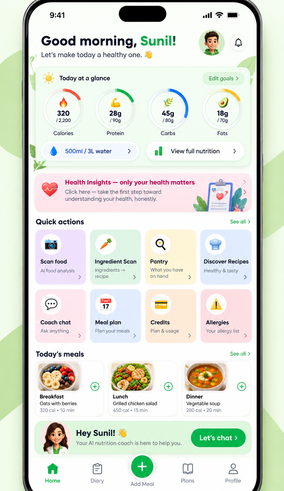
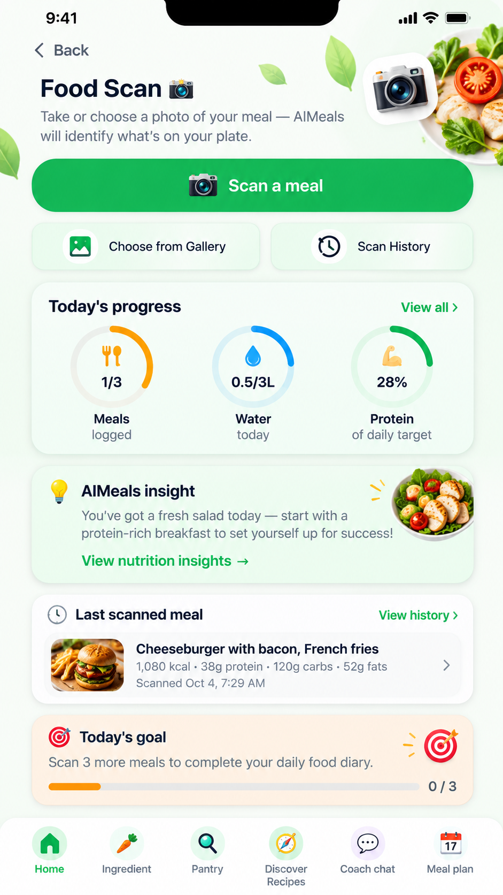
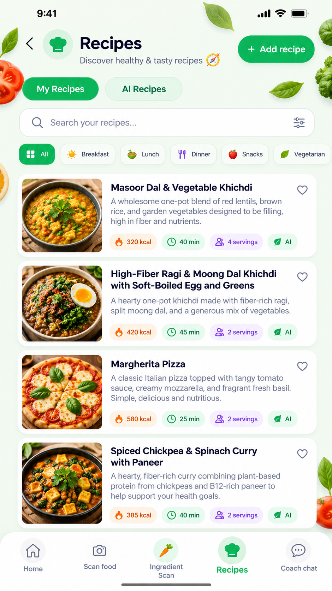
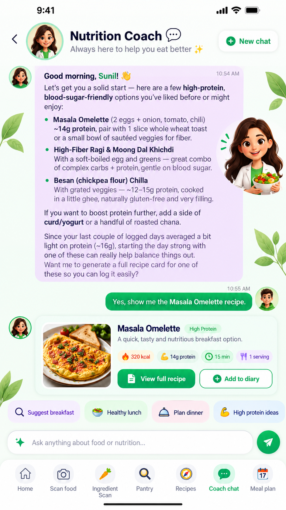
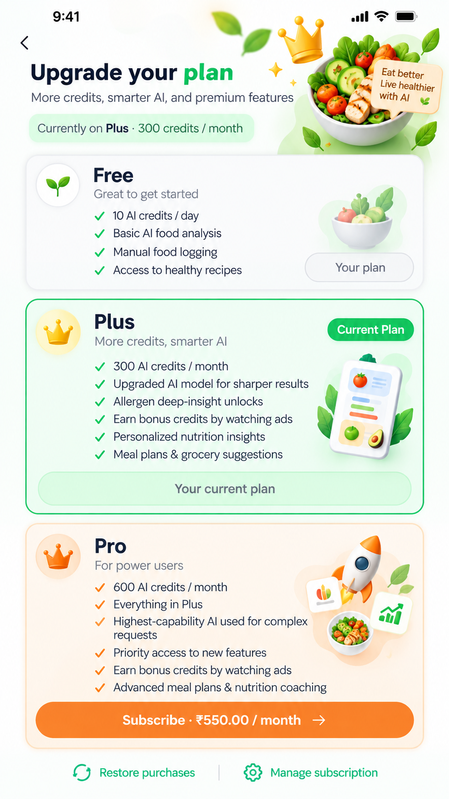
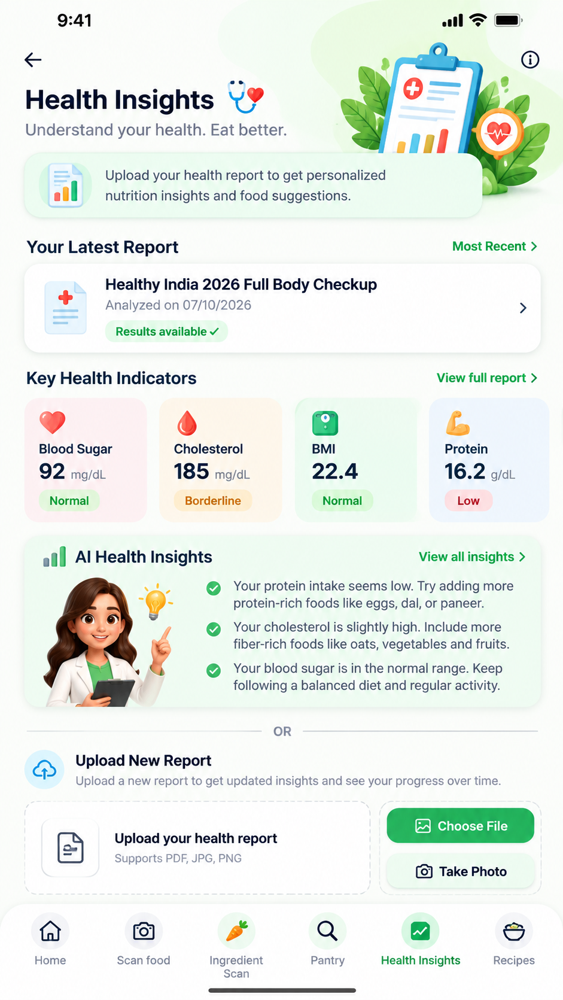
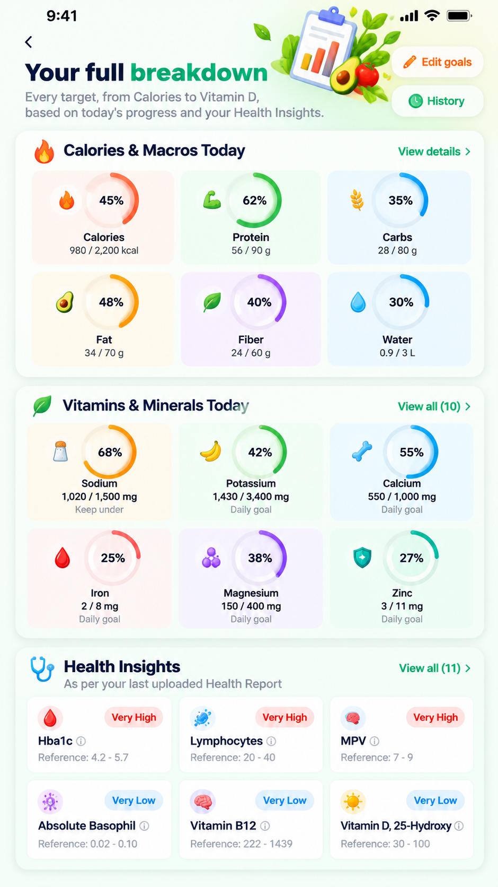
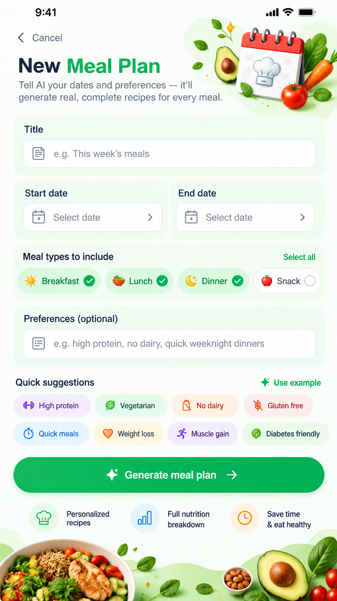

# AIMeals

📱 **Download AIMeals on Google Play:**
https://play.google.com/store/apps/details?id=com.aimeals.app

📸 **Follow us**
- Instagram: https://www.instagram.com/aiappdevloper
- YouTube: [AI App developer](https://www.youtube.com/@sunilkayz007)

**AI-powered meal planning, pantry tracking and nutrition logging — for your phone.**

AIMeals helps you decide what to cook, what to eat and how it fits your goals. Scan your ingredients or snap a photo of a meal, get recipes built from what's already in your kitchen, generate meal plans, and chat with an AI nutrition coach.

## Features

- **Pantry tracking** — keep track of what you have at home
- **Ingredient scanning** — add pantry items from a photo
- **Recipe generation** — recipes from your pantry or from a dish you want
- **Meal plans** — AI-generated weekly plans tuned to your goals
- **Nutrition logging** — log meals, estimate nutrition from food photos, track water and progress
- **Allergy awareness** — allergen insights and facts
- **AI coach** — streaming chat for nutrition and cooking questions
- **Health & goals** — body details, goals, achievements and health reports

## Screenshots

| | | |
| --- | --- | --- |
|  |  |  |
|  |  |  |
|  |  | |

More tablet layouts are in [`docs/screenshots/tablet/`](docs/screenshots/tablet/).

## Repository layout

| Path | What it is |
| --- | --- |
| `mobile/` | Expo / React Native app (TypeScript, expo-router) |
| `backend/` | FastAPI service: auth, pantry, recipes, meal plans, logs, AI endpoints |
| `docs/screenshots/` | Store and marketing images (phone and tablet) |

## Running locally

**Backend**

```bash
cd backend
python -m venv venv
source venv/bin/activate        # Windows: venv\Scripts\activate
pip install -r requirements.txt
cp .env.example .env            # then fill in your own values (see below)
```

You will need your own keys in `backend/.env` (for example an LLM API key, a database URL and a secret key). Never commit `.env` files.

**Mobile**

```bash
cd mobile
npm install
cp .env.example .env            # set EXPO_PUBLIC_API_URL to your backend
npx expo start
```

## Configuration and secrets

This repository does not contain any API keys, passwords, signing keystores or Firebase/Play configuration files. Those are supplied locally by each developer. Keep them out of version control.

## Status

Early-stage project under active development. Feedback and contributions via issues are welcome.

## License

All rights reserved. Licensing terms to be added by the author.
